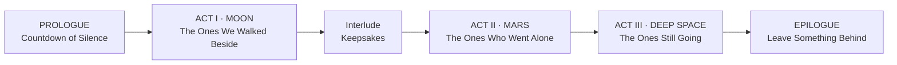
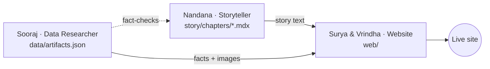

# STILL — Master Plan
### NASA Space Apps Challenge 2026 · *Abandoned but not Forgotten*

> *"They stopped talking. They never stopped mattering."*

> [!NOTE]
> Every fact, date, and number in this plan that comes from memory is marked **(verify)** for B, our Data Researcher. Nothing reaches the live site until it has a source link from NSSDCA or another official NASA source.

---

## 0. The idea in one sentence

**A scroll-driven journey outward from Earth: the Moon, then Mars, then deep space. The signal delay grows with every chapter, and each piece of hardware we left behind gets one last moment to tell you what it gave humanity.**

---

## 1. Creative concept and story arc

### 1.1 The hook: *"The Signal Delay"*
Every chapter has a small readout pinned to the top of the screen: **distance from Earth** and **one-way light time**.

| You are at… | Signal delay |
|---|---|
| Earth | 0 s |
| The Moon | ~1.3 s |
| Mars | ~3 to 22 min (changes with orbit) |
| Pioneer 10 | ~18+ hours (verify, compute at build) |

The further you scroll, the longer the echo, and the lonelier the hardware. The visitor *feels* distance without being told about it. This is the spine of the whole experience.

### 1.2 The thesis (the line the judges should remember)
> **"Abandoned" is the wrong word. These machines are still giving.**
> The Apollo mirrors still bounce our lasers back. Orbiters still photograph the rover tracks. Every lander shaped the next one.

Every character ends on a **Legacy beat**: what we know today *because it went*.

### 1.3 The narrative voice: two layers, always visually separate
| Layer | Style | Example |
|---|---|---|
| **The Voice** (imagined, emotional) | Serif italic, first person, the hardware "speaking". Labelled *imagined*. | *"They left their footprints next to me and went home. I didn't mind. Someone had to stay and hold the mirror."* |
| **The Record** (factual) | Monospace, short, with a citation chip linking to NSSDCA | `LANDED 1969-07-20 · SEA OF TRANQUILITY · NSSDCA 1969-059C (verify)` |

Being honest about what is imagined builds trust with judges ("Validity") and teaches kids the difference between story and evidence.

> [!IMPORTANT]
> Opportunity's famous "My battery is low and it's getting dark" is a **journalist's paraphrase** of its telemetry, not a real message. We say so on screen. It becomes a teaching moment, not an error.

### 1.4 Story arc: Prologue, 3 Acts, Epilogue (9 core characters)



**PROLOGUE: "Countdown of Silence"** (~10 s)
Black screen. One faint pulse. Text appears line by line:
> *Humans have left about 190 tonnes of hardware on the Moon (verify).*
> *More rests on Mars. Some is still drifting between the stars.*
> *None of it is forgotten.*
> **Scroll to listen.**

**ACT I · THE MOON: "The Ones We Walked Beside"** (warm silver accent)
| Character | Why it's emotional | Signature moment |
|---|---|---|
| **Surveyor 3** (1967) | The first robot that ever *got visitors*: Apollo 12 landed close by and brought parts of it home (verify details). | Then/Now photo pair |
| **Eagle's descent stage + the Apollo 11 retroreflector** | The platform it launched from is still sitting there, along with a mirror we still use. | ⭐ **"Ping the Moon"**: press, a laser line flies out, and ~2.5 s later the echo returns. Reveal: *the Moon drifts ~3.8 cm/year away from us. We know because of this mirror.* |
| **Lunar Roving Vehicle, Apollo 15** | The first car on another world, parked forever. | Tracks drawn in SVG, then the real LRO orbital photo showing the tracks still there |

**INTERLUDE: "Keepsakes"** (short, quiet, horizontal drift)
Personal objects left behind: Charlie Duke's family photo (Apollo 16), the *Fallen Astronaut* memorial (Apollo 15), Shepard's golf balls (Apollo 14). One line each. This is the human heartbeat between machines.

**ACT II · MARS: "The Ones Who Went Alone"** (rust accent; delay jumps to minutes)
| Character | Why it's emotional | Signature moment |
|---|---|---|
| **Viking 1 Lander** (1976) | The first long-lived American eyes on Mars (verify). | First-image scan-line reveal, the way the photo actually arrived line by line |
| **Opportunity** | Planned for 90 sols, kept going for ~14 years (verify). | ⭐ **Sol odometer**: counter races past "90 planned" and keeps going. The dust storm darkens the screen, and the counter stops. |
| **Ingenuity** | Planned 5 flights, flew 72 (verify). The first powered flight on another world. | Flight counter + a tiny SVG helicopter hop on each scroll step |

**ACT III · DEEP SPACE: "The Ones Still Going"** (faint blue accent; delay in hours)
| Character | Why it's emotional | Signature moment |
|---|---|---|
| **Snoopy** (Apollo 10 LM ascent stage) | Sent into orbit around the Sun in 1969 and lost. Astronomers think they may have found it again in 2019 (verify). | The UI zooms out to the Sun with a dotted orbit and a "?" marker |
| **Pioneer 10** | Last signal in 2003 (verify). It carries a plaque meant for whoever finds it. | ⭐ **"Send a message"**: type a word. It travels at light speed and the progress bar shows real arrival time. The UI keeps counting. |

**EPILOGUE: "Leave Something Behind"**
The astronauts left keepsakes. Now the visitor picks one object (photo, note, patch) and writes one line. They get a **shareable postcard** (canvas → PNG) with their message "placed" at an Apollo site, plus the real signal delay to that spot. Shareable postcards help the People's Choice vote.
Closing line: *"They're still here. Now, so are you."*

**Stretch characters** (only if ahead of schedule): Spirit, InSight, Sojourner, Phoenix, LRV 16/17, GRAIL Ebb & Flow.

### 1.5 Character template (same rhythm for every artifact)
1. **Arrival.** The SVG line-art draws itself, with name and nickname.
2. **The Voice.** 2–3 imagined lines.
3. **The Record.** 3 key numbers, a "Last contact" date, and a live "silent for N days" ticker.
4. **The Proof.** A Then/Now photo slider (mission photo vs. today's orbital image).
5. **The Legacy.** One sentence: *"Because of me, you know…"*
6. **Archive chip.** Links to the NSSDCA record for anyone curious.

---

## 2. Design and animation architecture

### 2.1 Visual language: "Museum at night"
- **Canvas:** near-black `#0A0A0B` (not pure black, which is easier on the eyes and gives richer contrast).
- **Ink:** off-white `#EDEAE3`. Secondary text `#8A877F`.
- **One accent per act:** Moon `#D9D3C3` (warm silver) · Mars `#C2502A` (rust) · Deep space `#7FA2FF` (faint blue). The accent shifts smoothly as you cross acts.
- **Type:** *Instrument Serif* or *Fraunces* (The Voice) · *Inter* (UI) · *JetBrains Mono* (The Record). All fonts self-hosted.
- **Illustration:** single-weight **line-art SVGs** of each spacecraft (1.25 px stroke). They're light, crisp at any size, and draw-on-able. No heavy 3D.
- **Photos:** real NASA imagery only, desaturated to fit the palette, with full colour revealed on interaction.
- **Layout:** lots of empty space and one idea per screen. Story text ≤ 60 characters per line.

### 2.2 Tech stack (chosen for speed, performance, and parallel work)
| Concern | Choice | Why |
|---|---|---|
| Framework | **Astro 5 + TypeScript** | Static output, almost zero JS by default, content collections for MDX/JSON. Each folder plugs in cleanly. |
| Content | **MDX** (story) + **JSON** (data) | Writers and researchers never touch components |
| Animation | **GSAP 3** (ScrollTrigger, SplitText, DrawSVG, all free now) (verify licence) | Industry standard, GPU-friendly, scrub/pin |
| Smooth scroll | **Lenis** | Lightweight inertial scroll that syncs with ScrollTrigger |
| Page transitions | **View Transitions API** (Astro built-in) | Native morph from overview to character page |
| Styling | Plain CSS + custom properties (design tokens) | No build-time coupling, tiny output |
| Starfield | One `<canvas>`, ~300 points, paused when off-screen | One draw loop for the whole site |
| Hosting | Vercel / Netlify / GitHub Pages | Push to deploy, preview URLs per branch |
| Design | Figma (tokens exported to `tokens.css`) | |

### 2.3 Motion rules (how it stays smooth)
1. **Animate only `transform` and `opacity`.** Never animate `width/height/top/left`, `box-shadow`, or `filter: blur`.
2. **One scroll engine.** Lenis + one GSAP ticker drives everything, with no competing scroll listeners.
3. **ScrollTrigger `scrub: 0.5–1`** for cinematic sections. Use time-based tweens (≤ 600 ms, `power3.out`) for micro-interactions.
4. **`will-change` only while animating**, removed afterwards.
5. **`content-visibility: auto`** on off-screen chapters. Lazy-load images with `IntersectionObserver`.
6. **Motion vocabulary (C owns, used everywhere):** `reveal` (fade + 16px rise), `drawLine` (SVG draw-on), `splitLines` (line-by-line text), `pinChapter` (pin + scrub), `counter` (numeric tween), `accentShift` (act colour change).
7. **`prefers-reduced-motion`:** every effect falls back to a simple fade. Pins become normal flow. This is a test requirement, not a nice-to-have.
8. **Micro-interactions:** magnetic hover on citation chips, and a cursor halo that slightly grows over interactive objects (desktop only). Purely visual and silent — no audio or voice-over to keep the experience fast and simple.

### 2.4 Budgets (Definition of "fast")
| Metric | Target |
|---|---|
| Lighthouse Performance / Accessibility | ≥ 95 / ≥ 95 |
| LCP / CLS | < 2.0 s / < 0.05 |
| JS shipped (gzip) | < 120 KB |
| Initial page weight | < 1.2 MB (AVIF/WebP, responsive `srcset`) |
| Frame rate | 60 fps on a mid-range Android phone |

### 2.5 Accessibility
WCAG AA contrast, full keyboard navigation for every interaction, alt text and captions on all media, a **reading level of roughly ages 10–14** for The Voice and Legacy lines, and a "Skip story → Archive view" link for people who only want the facts.

---

## 3. NASA data strategy

### 3.1 Sources
- **NSSDCA Master Catalog**: one record per spacecraft (`nssdc.gsfc.nasa.gov/nmc/spacecraft/display.action?id=<COSPAR ID>`). This is our ground truth for launch dates, mass, mission description, and IDs.
- **Official Space Apps 2026 challenge resources** for this challenge (B links every one in `data/sources.md`).
- **NASA Image & Video Library API** (`images-api.nasa.gov`) for mission photography (fetched at build time).
- **LRO / LROC** images of Apollo sites (descent stages and rover tracks visible from orbit) and **MRO HiRISE** images of Mars landers. These power **The Proof**.
- **JPL Horizons** (optional) to compute live distances and light times for Mars and Pioneer 10 at build time.

### 3.2 Progressive disclosure: three depths, never more than one at a time
| Depth | Who it's for | What's shown |
|---|---|---|
| **1 · Story** | Everyone | Voice lines, one Legacy sentence, one big number |
| **2 · Record** (tap "Open the record") | Curious users | 3–5 stats, last contact, location, Then/Now |
| **3 · Archive** (tap the citation chip) | Teachers, judges | NSSDCA ID, full source list, links out |

Rule: **at most 3 numbers on screen at once**, always with a human-scale comparison (e.g. *"45 km, about 100 laps of a running track"*, verify).

### 3.3 The data contract (B owns, everyone builds against it from hour 2)
```ts
// data/schema.ts
export interface Artifact {
  slug: string;                 // "opportunity" (also the A story filename)
  name: string;                 // "Mars Exploration Rover B"
  nickname?: string;            // "Opportunity"
  act: "moon" | "mars" | "deep";
  order: number;                // position in act
  mission: string;
  nssdcaId: string;             // COSPAR ID, e.g. "2003-032A" (verify)
  launchDate: string;           // ISO
  arrivalDate?: string;
  lastContact: string;          // ISO, drives the "silent for N days" ticker
  status: "silent" | "lost" | "still-used" | "drifting";
  location: { body: "Moon"|"Mars"|"Heliocentric"|"Interstellar"; site?: string; lat?: number; lon?: number };
  distanceKm: number;           // from Earth (avg or build-time computed)
  lightTimeSec: number;         // one-way
  planned?: { value: number; unit: string };  // e.g. 90 sols
  actual?:  { value: number; unit: string };  // e.g. 5352 sols (verify)
  stats: { label: string; value: string; comparison?: string; sourceUrl: string }[];
  legacy: string;               // one sentence, fact-checked
  images: { then?: Img; now?: Img; lineArt: string /* C's svg filename */ };
  sources: string[];            // every claim traceable
  verified: boolean;            // B sets true after checking
}
interface Img { src: string; alt: string; credit: string; sourceUrl: string }
```
The site build **fails if `verified` is false** in production mode, so nothing unchecked can ship.

### 3.4 Licensing and rules
NASA imagery is generally free to use with credit. **Do not use the NASA logo ("meatball") or anything that suggests NASA endorses us** (Space Apps rule). Credit every image on screen.

---

## 4. Four-member role and task division

### 4.1 The team: Nandana (Story) · Sooraj (Data) · Surya & Vrindha (Website)

| Member(s) & Role | Folder | Owns | In one line |
|---|---|---|---|
| **Nandana · Storyteller** | `story/` | Story arc, every word on screen, voice guide, demo script, pitch | *How it feels* |
| **Sooraj · Data Researcher (Fact Guardian)** | `data/` | NSSDCA research, `artifacts.json`, data contract, images, light-time maths, fact-checking Nandana's copy | *What is real* |
| **Surya & Vrindha · Website Team** | `web/` | UI design, tokens, components, SVG line-art, motion helpers, interactive moments, Astro app, scroll engine, Signal HUD, deploy | *How it looks, moves, and ships* |

### 4.2 Project structure
```
Nasa_Space_Apps_Challenge/          ← repo root, project "still"
├── MASTER_PLAN.md · README.md · package.json · .github/CODEOWNERS
├── story/                        Nandana · content (MDX), no build tools
│   ├── voice-guide.md
│   └── story/<slug>.mdx
├── data/                         Sooraj · content (JSON), no build tools
│   ├── data/schema.ts · data/artifacts.json
│   ├── images/
│   └── sources.md
└── web/                      Surya & Vrindha · Astro 5 app (@still/web)
    └── src/ tokens/ · motion/ · components/ · illustrations/ · interactions/ · pages/ · scripts/engine.ts
```

**Rule: a folder is an ownership boundary.** Nandana writes in `story/`, Sooraj writes in `data/`, and Surya & Vrindha collaborate in `web/`. `web/` *reads* `story/` and `data/` directly.



### 4.3 The four contracts (the only things people must agree on)
| Contract | File | Owner | Consumers |
|---|---|---|---|
| Data shape | `data/schema.ts` (+ zod copy in `web/src/content.config.ts`) | Sooraj | Surya & Vrindha, Nandana |
| Story frontmatter | `story/voice-guide.md` | Nandana | Surya & Vrindha |
| Slugs (IDs) | the 9 slugs below. Same name for the JSON key, the `.mdx` file and the `.svg` file | All | All |

Cast slugs: `surveyor-3, eagle, lrv-15, keepsakes, viking-1, opportunity, ingenuity, snoopy, pioneer-10` (+ `prologue`, `epilogue`).

### 4.4 How each member moves forward

**Nandana · Storyteller** (no coding: writes Markdown)
1. Hours 0–8: lock the arc, finish `voice-guide.md`, write Prologue + Act I.
2. Hours 8–20: Acts II and III, Keepsakes. Send every factual line to Sooraj.
3. Hours 20–32: Epilogue. Tighten every line read aloud to a 12-year-old.
4. Hours 32–46: demo script and pitch.

*Daily loop:* write `story/<slug>.mdx` → see it live (`npm run dev`) → Sooraj checks the facts → done.

**Sooraj · Data Researcher** (no coding: writes JSON)
1. Hours 0–2: confirm the schema with Vrindha. Collect the challenge's official resource links in `sources.md`.
2. Hours 2–10: NSSDCA records for Moon + Mars characters into `artifacts.json`.
3. Hours 10–20: deep-space characters, Then/Now image pairs (LROC / HiRISE), light times.
4. Hours 20–32: fact-check Nandana's copy, set `verified: true` per entry.
5. Hours 32–46: credits/sources page content, submission write-up.

*Daily loop:* NSSDCA record → JSON entry with `sourceUrl`s → site shows it → tick tracker.

**Surya & Vrindha · Website Team (`web/`)**
1. Hours 0–2: tokens v1, Astro app + preview deploys running with stubs ✅ (done).
2. Hours 2–10: key screens, chapter layout per act, act intros, polish ChapterHero / VoiceBlock / RecordCard.
3. Hours 10–20: 9 SVG line-arts, `ThenNowSlider`, `PingTheMoon`, `SolOdometer`, Archive view, SEO/social card.
4. Hours 20–32: `FlightCounter`, `SendAMessage`, Epilogue postcard (canvas → PNG), View Transitions, mobile layouts.
5. Hours 32–46: Lighthouse ≥ 95, a11y audit, reduced-motion pass, real-device testing, `build:strict`, final deploy.

*Daily loop:* build UI/motion or integrate Nandana & Sooraj's changes in `web/` → preview URL to team → polish.

### 4.5 48-hour timeline and sync points
| Hours | Nandana · Story (`story`) | Sooraj · Data (`data`) | Surya & Vrindha · Website (`web`) |
|---|---|---|---|
| **0–1.5** | 🤝 **Kickoff**: agree on contracts and slugs ✅ |||
| **1.5–8** | Voice guide, Prologue, Act I | Act I + II data | Figma, tokens v1, layout, act structure, deploy |
| **8–10** | 🔄 **SYNC 1**: Opportunity chapter end-to-end with real data, real copy, polished components, on a real phone |||
| **10–20** | Acts II + III, Keepsakes | Act III data, images | SVGs, first 3 interactions, Archive |
| **20–22** | 🔄 **SYNC 2**: full scroll-through, all 9 chapters. **Cut list decided.** |||
| **22–32** | Epilogue, tighten | Fact-check, `verified: true` | Last interactions, postcard, transitions, mobile |
| **32** | 🧊 **CONTENT FREEZE** (Nandana + Sooraj stop changing content) |||
| **32–40** | Video script + recording | Sources page, write-up | Polish, QA, performance, a11y, devices |
| **40–46** | Video edit, pitch | Submission form | Social card, final deploy |
| **46–48** | 🛟 **Buffer** |||

### 4.6 Definition of Done (per chapter)
- [ ] **Sooraj:** JSON entry `verified: true`, every stat has a `sourceUrl`
- [ ] **Nandana:** Voice ≤ 3 lines, Legacy = 1 sentence, approved by Sooraj
- [ ] **Surya & Vrindha:** SVG < 15 KB, draws cleanly, interaction has keyboard + reduced-motion path, renders at 60 fps, passes `build:strict`

### 4.7 Git workflow
- `main` is protected and auto-deploys. Every pull request gets a preview URL.
- Branch names: `story/…` (Nandana), `data/…` (Sooraj), `web/…` (Surya & Vrindha). CODEOWNERS routes reviews to the folder owner(s).
- **Rule of 15:** blocked for 15 minutes? Post it in chat, use the stub and keep moving.

---

## 5. Judging fit (Space Apps criteria)
| Criterion | How STILL answers it |
|---|---|
| **Impact** | Makes kids care about engineering legacy, using the Proof photos and live "still used" retroreflectors |
| **Creativity** | Signal Delay spine, hardware as characters, the visitor leaves a keepsake |
| **Validity** | Two-layer voice (imagined vs. record), every number cited to NSSDCA, build fails on unverified data |
| **Relevance** | Moon, Mars, and deep-space discarded hardware, exactly the challenge brief |
| **Presentation** | Cinematic, minimal, fast, shareable |

## 6. Risks and mitigations
| Risk | Mitigation |
|---|---|
| Scope creep | 9 characters fixed, stretch list only after SYNC 2 |
| Factual errors | `verified` gate + B owns fact-check of all copy |
| Janky animation on phones | transform/opacity only, test on a real mid-range phone at SYNC 1 |
| Integration hell | Folder ownership + npm workspaces + stubs at hour 1.5 + two hard syncs |
| Asset licensing | NASA-only imagery, credits on screen, no NASA logo |

---

### Team & Decisions
- **Title:** *STILL*
- **Audio:** Silent by design (clean UI + story only, no sound effects or voice-over).
- **Team:** **Nandana** (`story/`) · **Sooraj** (`data/`) · **Surya & Vrindha** (`web/`)
